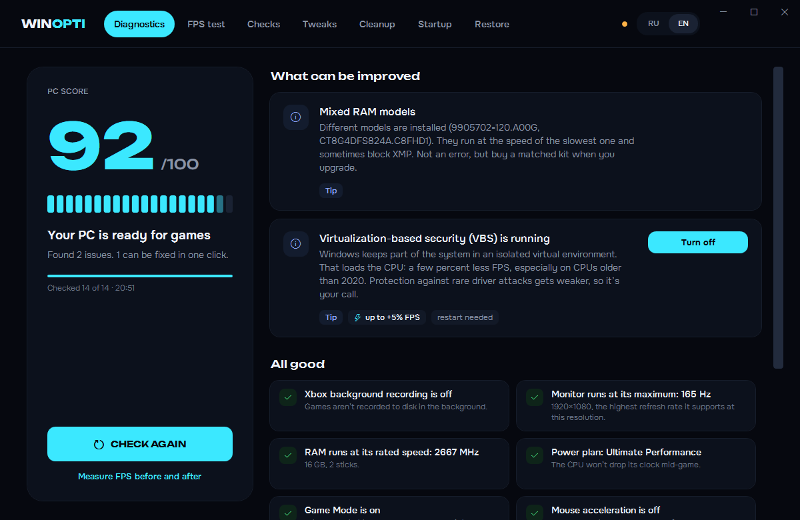

# WinOpti 2

Программа для игроков на Windows 10 и 11. Находит настоящие причины низкого FPS и фризов, исправляет их в один клик
и показывает результат цифрами: замер FPS до и после, прямо в твоей игре.

**Русский** · [English](#english)


| Замер FPS и «Что мешало игре» | Проверки |
|---|---|
|  |  |

## Скачать

1. Открой [последний релиз](../../releases/latest) и скачай `WinOpti-2.0.0-beta.2.exe` — это один файл, установка не нужна.
2. Запусти и разреши запуск от имени администратора: без этого Windows не даст менять настройки и замерять FPS.

Дальше WinOpti обновляется сама: когда выйдет новая версия, в шапке появится кнопка «Обновить».

Нужен .NET Framework 4.8 — он уже встроен в Windows 10 (с 2019 года) и Windows 11.

> **SmartScreen может предупредить** о неизвестной программе: exe пока не подписан цифровой подписью.
> Нажми «Подробнее» → «Выполнить в любом случае». Весь исходный код — в этом репозитории.

> **Это бета.** Всё работает, но проверено пока на небольшом числе компьютеров. Если что-то сломается,
> WinOpti сама предложит отправить отчёт — это очень поможет.

## Что умеет

| Раздел | Что внутри |
|---|---|
| **Диагностика** | 14 проверок того, что реально съедает FPS: частота монитора ниже возможной, медленная или разная память, план питания, VBS, игровой режим, Game DVR, ускорение мыши, драйвер видеокарты, игры на HDD, фоновая нагрузка. Оценка ПК от 0 до 100 и исправление в один клик |
| **Замер FPS** | Средний FPS, 1% и 0.1% low, фризы — через Intel PresentMon, как у обзорщиков. Серия из 3 проходов с разбросом. «До» и «После», картинка результата для друзей |
| **Что мешало игре** | Во время замера WinOpti смотрит, какие программы грузили процессор и видеокарту и кто просыпался в момент фризов. Видеокарта NVIDIA: перегрев, сброс частоты, нехватка питания. Процессор: сброс частоты под нагрузкой. Для каждой находки — кнопка исправления, а потом «Исправить всё и замерить снова» |
| **Проверки** | Авто-игровой режим (сам включается, когда запускаешь игру), реальная частота опроса мыши, пинг до серверов Valve и где проблема — в Wi-Fi или у провайдера, игры на правильной видеокарте, монитор в разъёме видеокарты, настройки драйвера NVIDIA, советы для AMD Radeon |
| **Твики** | 32 твика с описанием простыми словами, риском и откатом: телеметрия, фон, интерфейс, игры и ввод |
| **Очистка** | Временные файлы, кэш обновлений, отчёты об ошибках, старые установщики драйверов, кэш шейдеров |
| **Автозагрузка** | Программы, службы и приложения из Microsoft Store: сколько каждая занимает памяти прямо сейчас, подсказки, что можно выключить |
| **Откат** | Откат любого изменения WinOpti, точки восстановления Windows, понятный журнал действий |

Без лагов: окно открывается за полсекунды, фоновый игровой режим занимает около 40 МБ и меньше 0,2% процессора.
Интерфейс на русском и английском — переключатель RU / EN в шапке.

## Что уходит в интернет

По умолчанию — почти ничего:

- **Проверка обновлений** — при запуске WinOpti спрашивает у GitHub список релизов. Никаких данных о тебе не отправляется.
- **Пинг** — только по кнопке: список серверов берётся у Steam, сами пинги идут на серверы Valve и твой роутер.
- **Отчёт об ошибке** — только если ты сам нажмёшь «Сообщить на GitHub». В нём версия WinOpti и Windows, модель железа
  и текст ошибки; имя пользователя из путей вырезается. Перед отправкой отчёт видно целиком.
- **Сравнение «Твой ПК против похожих»** — включается только по кнопке и отправляет лишь модели процессора
  и видеокарты, объём памяти, разрешение экрана и FPS.

## Есть видеокарта AMD? Помоги

Для NVIDIA WinOpti переключает настройки драйвера сам, для AMD Radeon пока только подсказывает. Чтобы это исправить,
нужны снимки настроек с живой карты: «Проверки» → «Настройки AMD Radeon» → «Снимок настроек», поменяй Anti-Lag
в AMD Software, сделай второй снимок и приложи оба файла `winopti-amd-*.txt` к [issue](../../issues/new).
Снимок только читает настройки, ничего не меняет.

## Собрать из исходников

```
dotnet build WinOpti.csproj -c Release
```

C# и WPF на .NET Framework 4.8. Сервер для сравнения ПК — в папке `cloud/` (Cloudflare Worker).

Первая версия на Python — в ветке [`v1`](../../tree/v1).

## Благодарности

- [Intel PresentMon](https://github.com/GameTechDev/PresentMon) — замер кадров (MIT, лицензия в `Tools/`).
- Шрифты [Onest](https://fonts.google.com/specimen/Onest) и [Unbounded](https://fonts.google.com/specimen/Unbounded) — SIL Open Font License (тексты лицензий в `Assets/Fonts/`).

---

<a id="english"></a>

# WinOpti 2 (English)

A tool for PC gamers on Windows 10 and 11. It finds the real causes of low FPS and stutter, fixes them in one click
and proves the result with numbers: a before/after FPS benchmark in your own game.



**Download:** [latest release](../../releases/latest) → `WinOpti-2.0.0-beta.2.exe`, run as administrator. No installer.
WinOpti updates itself: when a new version is out, an "Update" button appears in the header.
Requires .NET Framework 4.8 (built into Windows 10 since 2019 and Windows 11). The exe is not code-signed yet,
so SmartScreen may warn: click "More info" → "Run anyway". This is a beta — if something breaks, WinOpti offers
to send an error report.

The interface is available in English and Russian (RU / EN switch in the header; picked automatically from your Windows language).

**Features**

- **Diagnostics** — 14 checks for what actually costs FPS (monitor below its max refresh rate, slow or mixed RAM,
  power plan, VBS, Game DVR, mouse acceleration, GPU driver age, games on an HDD, background load), a 0–100 score
  and one-click fixes.
- **FPS benchmark** — average FPS, 1% and 0.1% lows and stutters via Intel PresentMon, a 3-pass series with spread,
  before/after comparison and a shareable result card.
- **What hurt your game** — while benchmarking, WinOpti records which processes used CPU/GPU and which woke up during
  stutters, plus NVIDIA GPU temperature, clock drops and power limits, and CPU frequency drops. Every finding has a
  fix button, then "fix all and benchmark again".
- **Checks** — automatic game mode, real mouse polling rate, ping and jitter to Valve servers (Wi-Fi vs ISP),
  games on the right GPU, monitor plugged into the GPU, NVIDIA driver settings, AMD Radeon tips.
- **Tweaks, cleanup, startup manager, restore** — every change can be rolled back.

**Privacy:** on start WinOpti asks GitHub for the release list (nothing about you is sent). The ping test talks to
Steam's public server list and Valve servers. Error reports are sent only when you click "Report on GitHub" and you see
the full text first (your user name is stripped from paths). The "your PC vs similar PCs" comparison is opt-in and
sends only CPU/GPU model, RAM size, resolution and FPS.

**Got an AMD card?** WinOpti can switch NVIDIA driver settings but only gives tips for Radeon so far. Checks → AMD Radeon
settings → "Take snapshot", change Anti-Lag in AMD Software, take another one and attach both `winopti-amd-*.txt`
files to an [issue](../../issues/new). The snapshot is read-only.

**Build:** `dotnet build WinOpti.csproj -c Release` (C#/WPF, .NET Framework 4.8). The Python v1 lives in the
[`v1`](../../tree/v1) branch.

## License

[MIT](LICENSE)
