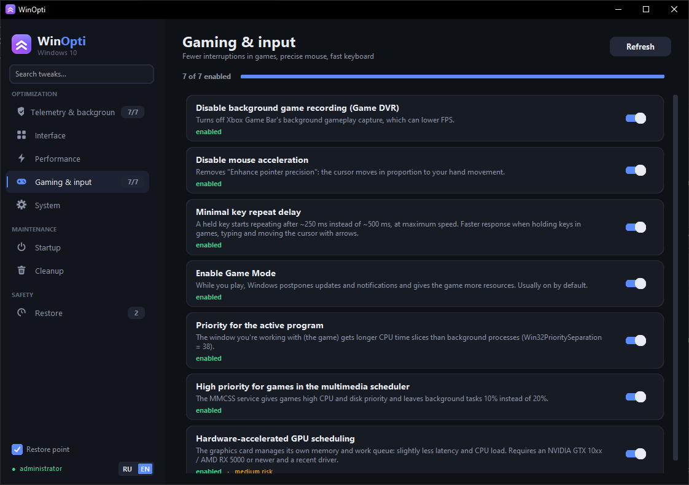
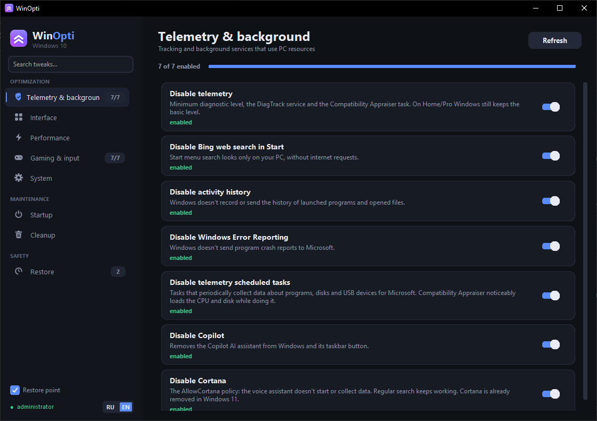
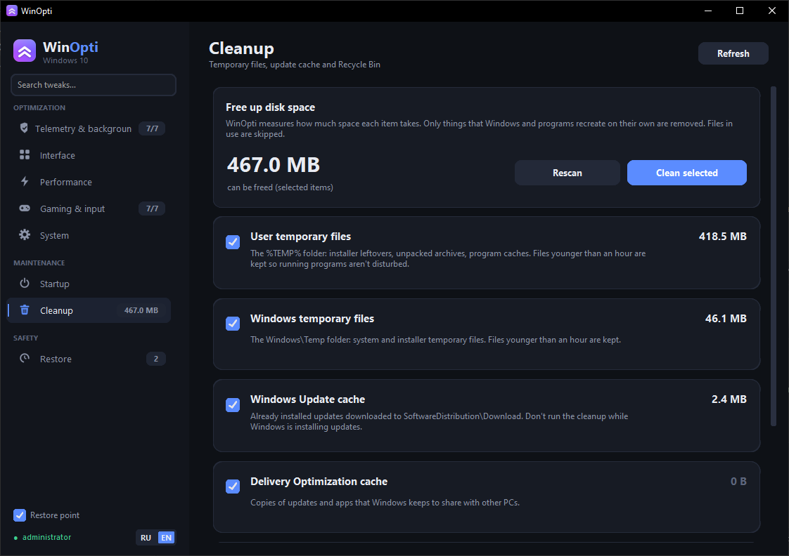

# WinOpti

Оптимизатор Windows 10 и 11 для игр и повседневной работы. Отключает фоновую нагрузку и слежку, ускоряет
отклик интерфейса и даёт играм больше ресурсов. Почти все твики срабатывают сразу, без перезагрузки и
перезахода в систему, и любой из них можно откатить.

**Русский** · [English](#english)



| Телеметрия и фон | Очистка |
|---|---|
|  |  |

## Скачать

1. Открой страницу [Releases](../../releases/latest) и скачай `WinOpti.exe` — это один файл, больше
   ничего не нужно.
2. Запусти его и разреши запуск от имени администратора — без этого Windows не даст менять настройки.

Python ставить не нужно: всё уже внутри exe. Первые пару секунд после запуска программа распаковывается.

> **Windows SmartScreen или антивирус могут предупредить** о неизвестной программе: exe не подписан
> цифровой подписью, а такие программы (собранные PyInstaller) антивирусы иногда помечают по ошибке.
> В SmartScreen нажми «Подробнее» → «Выполнить в любом случае». Весь исходный код — в этом репозитории.

## Что умеет

| Вкладка | Что внутри |
|---|---|
| **Телеметрия и фон** | Телеметрия и её задачи в планировщике, журнал действий, веб-поиск Bing в Пуске, Copilot, Cortana, отчёты об ошибках |
| **Интерфейс** | Анимации окон, прозрачность, задержка меню, виджеты, реклама на экране блокировки и автоустановка рекламных приложений, окно залипания клавиш |
| **Производительность** | План питания «Максимальная производительность», Power Throttling, SysMain, индексирование поиска, фоновые приложения, Edge в фоне, ненужные службы |
| **Игры и ввод** | Game DVR, игровой режим, приоритет активной программы, MMCSS для игр, аппаратное планирование GPU, ускорение мыши, задержка повтора клавиш |
| **Система** | Раздача обновлений другим ПК, перезагрузка после обновлений |
| **Автозагрузка** | Что запускается вместе с Windows: включение и выключение без удаления, подсказки, что можно выключить |
| **Очистка** | Временные файлы, кэш обновлений Windows, кэш оптимизации доставки, отчёты об ошибках, корзина |
| **Восстановление** | Откат любого изменения WinOpti, точки восстановления Windows, журнал |

У каждого твика указан риск и что именно он меняет. Поиск в меню находит твики по названию и описанию.
Интерфейс на русском и английском (переключатель внизу меню).

## Безопасность

- Перед первым включением твика WinOpti создаёт точку восстановления Windows (если за последние сутки её
  ещё не было). Это можно выключить галочкой внизу меню.
- Исходные значения сохраняются, и на вкладке «Восстановление» любое изменение откатывается одной кнопкой.
- Очистка удаляет только то, что Windows и программы создают заново сами; файлы младше часа не трогает.

Используешь на свой риск: это настройки системы, и на каждом ПК они могут вести себя по-своему.

## Результат на моём ПК

CS2, встроенная бенчмарк-карта, один и тот же ПК, два прогона: без твиков и со включёнными твиками WinOpti.

| | Средний FPS | 1% low |
|---|---|---|
| Без твиков | 220,2 | 95,4 |
| С WinOpti | 238,3 | 116,5 |
| Разница | **+8%** | **+22%** |

1% low — это самые просадочные кадры: чем выше, тем меньше статтеров. На другом железе результат будет другим.

## Сборка из исходников

Нужен Python 3 (проверено на 3.14) и Windows.

```
pip install -r requirements.txt
python gui.py          # запустить окно (для изменений — от имени администратора)
python build.py        # собрать dist/WinOpti.exe (один файл)
python main.py list    # консольная версия: list, on, off, scan, clean
```

Твики описаны в `tweaks.json`, их применение и откат — в `engine.py`.

## English

[Русский](#winopti) · **English**

WinOpti is a Windows 10/11 optimizer for gaming and everyday work. It turns off background load and
telemetry, speeds up UI response and gives games more resources. Almost every tweak applies immediately,
without a reboot or re-login, and any of them can be reverted.

### Download

1. Open [Releases](../../releases/latest) and download `WinOpti.exe`: it is a single file, nothing else is needed.
2. Run it and allow it to run as administrator: Windows does not let programs change settings otherwise.

No Python needed, everything is inside the exe. The first couple of seconds after launch it unpacks itself.

> **Windows SmartScreen or an antivirus may warn** about an unknown program: the exe is not code-signed, and
> such programs (built with PyInstaller) are sometimes flagged by mistake. In SmartScreen click
> "More info" → "Run anyway". All the source code is in this repository.

### Features

| Tab | What's inside |
|---|---|
| **Telemetry & background** | Telemetry and its scheduled tasks, activity history, Bing web search in Start, Copilot, Cortana, error reporting |
| **Interface** | Window animations, transparency, menu delay, widgets, lock screen ads and promo app installs, Sticky Keys popup |
| **Performance** | Ultimate Performance power plan, Power Throttling, SysMain, search indexing, background apps, Edge in the background, unneeded services |
| **Gaming & input** | Game DVR, Game Mode, foreground priority, MMCSS for games, hardware-accelerated GPU scheduling, mouse acceleration, key repeat delay |
| **System** | Delivery Optimization to other PCs, restarts after updates |
| **Startup** | What starts with Windows: turn entries on and off without deleting them, hints on what is safe to disable |
| **Cleanup** | Temp files, Windows Update cache, Delivery Optimization cache, error reports, Recycle Bin |
| **Restore** | Revert any WinOpti change, Windows restore points, history |

Every tweak shows its risk and exactly what it changes. Search in the menu finds tweaks by name and
description. The interface is in Russian and English (toggle at the bottom of the menu).

### Safety

- Before the first tweak WinOpti creates a Windows restore point (if there was none in the last 24 hours).
  You can turn this off with the checkbox at the bottom of the menu.
- Original values are saved, and on the Restore tab any change is reverted with one button.
- Cleanup deletes only what Windows and programs recreate themselves, and never touches files younger than an hour.

Use at your own risk: these are system settings, and they may behave differently on every PC.

### Result on my PC

CS2, built-in benchmark map, the same PC, two runs: without tweaks and with WinOpti tweaks on.

| | Average FPS | 1% low |
|---|---|---|
| Without tweaks | 220.2 | 95.4 |
| With WinOpti | 238.3 | 116.5 |
| Difference | **+8%** | **+22%** |

1% low is the worst frames: the higher it is, the less stutter. Results will differ on other hardware.

### Build from source

You need Python 3 (tested on 3.14) and Windows.

```
pip install -r requirements.txt
python gui.py          # run the window (as administrator to change settings)
python build.py        # build dist/WinOpti.exe (single file)
python main.py list    # console version: list, on, off, scan, clean
```

Tweaks are described in `tweaks.json`, applying and reverting them is in `engine.py`.

## Лицензия · License

[MIT](LICENSE)
